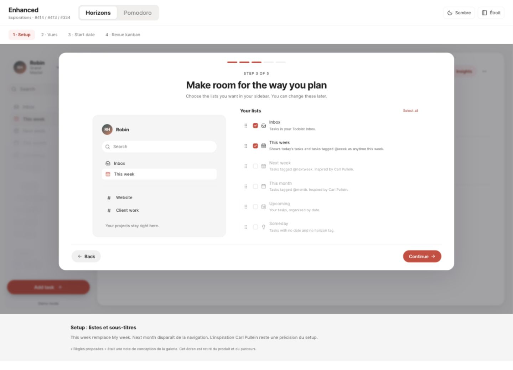
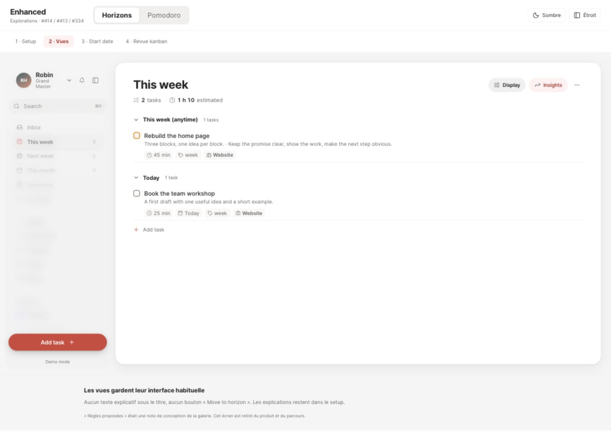
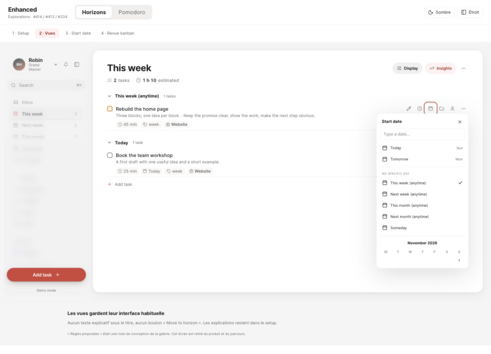
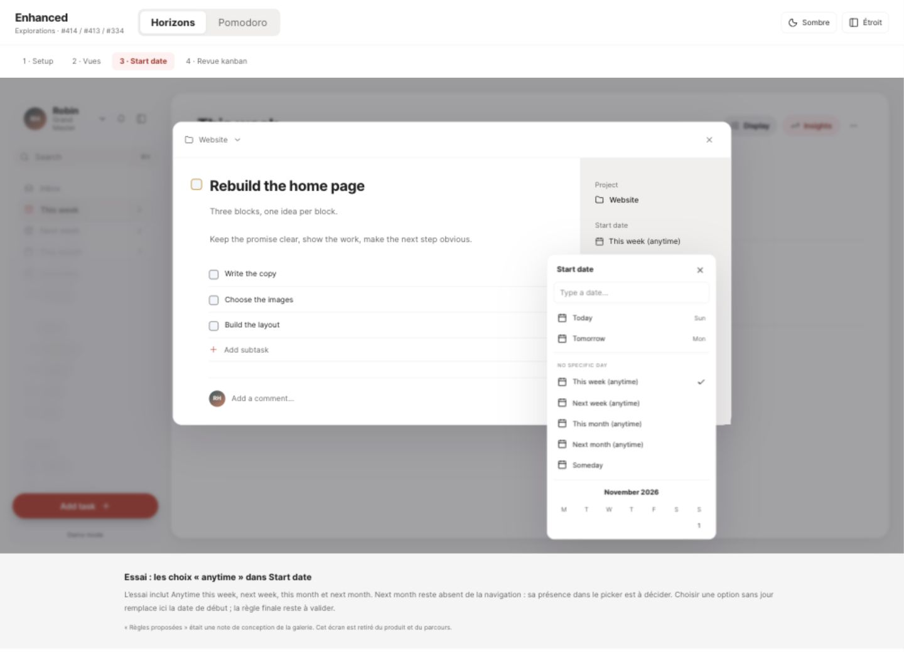

# Time sectors — issue #414

Reviewed Horizons direction; product implementation is pending.

These screenshots are from a local interactive prototype built with Enhanced's own styles, icons, PageHeader and TaskRow. All content is fictitious demo data.

## Screens

### Setup

### Native view

### Row date action

### Open task

## Scope

Native tag-based sidebar views preserve Todoist project membership. My week becomes This week. Next week and This month are added; Next month is excluded from the sidebar. Upcoming remains date-based.

Undated picker labels use “This week (anytime)”, “Next week (anytime)” and “This month (anytime)”. “Next month (anytime)” is shown for discussion in the picker only.

Review integration is deferred. The precise-date replacement rule, conflicting horizon tags, recurrence and rollover behavior still require explicit decisions before product implementation.

The issue body is the current specification; these screenshots illustrate it and are not evidence of a shipped feature or real-account validation.
